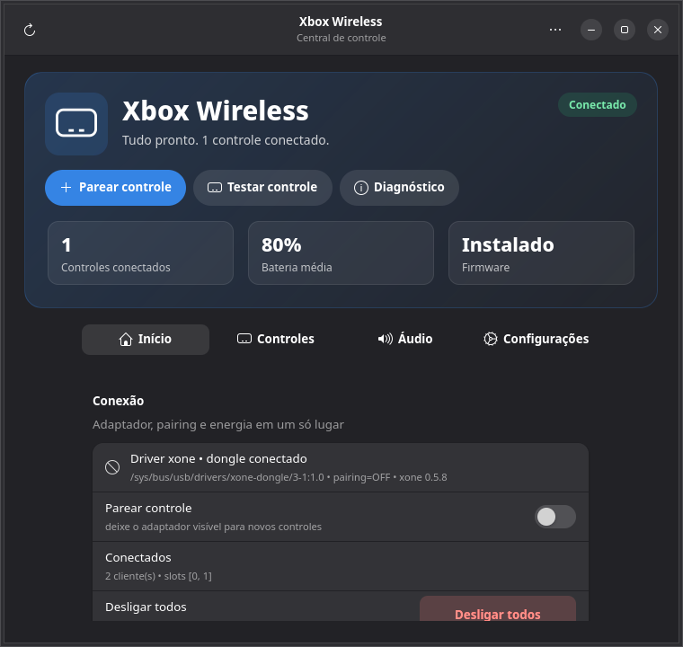
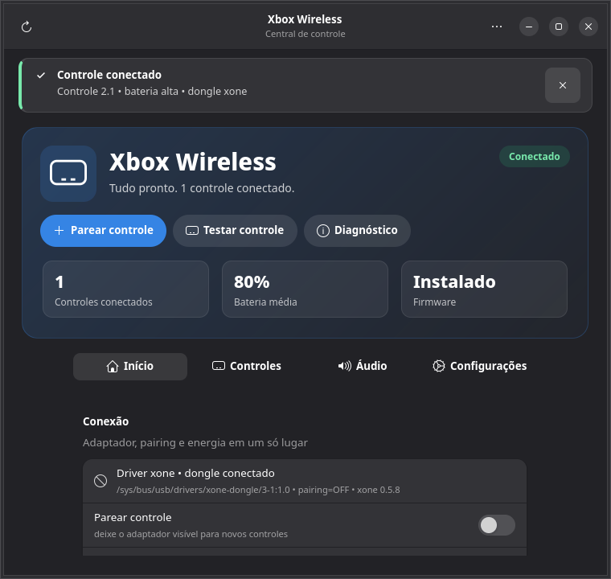

# Xbox Wireless GUI

[](LICENSE)
[](fedora/xbox-wireless-gui.spec)
[](https://github.com/viniciussralves/xbox-wireless-gui/actions/workflows/ci.yml)

Interface GTK4 + Libadwaita para gerenciar o **Xbox Wireless Adapter** no Linux,
com gestão de controles, LED, bateria, áudio e diagnóstico.
Backend com detecção automática **xone (atual) + xow (legado)**.
Empacotamento alvo: **Fedora (RPM/COPR)**.





## Estado atual (testado em Fedora 44 KDE)
- `xone_dongle` + dongle `045e:02e6` detectados, `pairing=0`, controle conectado.
- GTK4 + Libadwaita + UPowerGlib OK. `python3-evdev`, `evtest` instalados via dnf.
- Suite com 248 testes, cobertura de linha ≥95% em `src/`.

## Uso (dev)
```sh
./run.sh
# ou
python3 src/main.py
# se o grupo xboxwireless foi criado nesta sessão e ainda não está ativo:
sg xboxwireless -c './run.sh'
```

> O grupo só passa a valer em novas sessões; `sg xboxwireless -c ...` aplica
> imediatamente ao processo atual sem precisar reiniciar a sessão.

### CLI (sem abrir a janela)
```sh
python3 src/main.py --status
python3 src/main.py --status --json
python3 src/main.py --version
python3 src/main.py --diagnose
python3 src/main.py --pair on
python3 src/main.py --poweroff 0     # ou -1 para todos
python3 src/main.py --led gip0.0:white:status 2 30
python3 src/main.py --background   # serviço de notificações/perfis
python3 src/main.py --verbose --status
```

## Funcionalidades
- Detectar driver (xone sysfs `/sys/bus/usb/drivers/xone-dongle/*/pairing` / xow systemd), com suporte a múltiplos dongles.
- Diferenciar **dongle plugado sem driver**, **xow instalado mas parado** e ausência real de adaptador.
- Ativar/desativar pairing (via `pkexec` — polkit), com tempo decorrido (xone), contagem regressiva de 20s (xow) e **auto-off configurável**.
- Listar controles (`/sys/class/leds/gip*` + evdev), incluindo Bluetooth (xpadneo) com botão Desconectar.
- **Bateria honesta**: usa o nível do UPower quando o percentual não é confiável e casa bateria/controle por serial.
- **Desligar controle** via `poweroff` do xone (um cliente ou todos), com confirmação.
- LED mode/brightness (xone sysfs), com todos os modos do driver (off/on/blink/fade), **perfil salvo por serial** e reaplicação ao reconectar.
- Teste de vibração via evdev ff-rumble, com duração, intensidade e **motores forte/fraco separados** (persistidos em GSettings).
- **Testador de botões 2.0**: desenho ao vivo, zona morta configurável, log de eventos evdev, botões desconhecidos/Share quando expostos e cópia do estado.
- **Áudio/headset**: detecta card/sinks/sources do xone e permite definir padrão, volume e mute via `pactl`.
- **Bluetooth**: lista controles Xbox pareados no BlueZ e conecta/confia.
- **Diagnóstico copiável**: kernel, distro, módulo xone/versão, Secure Boot, dongle, clientes ativos, firmware, udev/grupo, evdev, UPower e áudio.
- **Notificações** de conexão/desconexão e bateria baixa.
- **Dashboard em abas**: Início, Controles, Áudio e Configurações, com nomes simples e foco em cada tarefa.
- **Barra de notificação detalhada** com título, descrição, ação e fechamento para conexão, pareamento, firmware, permissões e bateria.
- **CLI** para Waybar/scripts e **wakeup** do PC pelo controle.
- **Atualização orientada a eventos**: Gio.FileMonitor em `/dev/input`/LEDs + sinais do UPower, com polling como fallback.
- **API D-Bus de sessão** (`com.github.xboxwirelessgui.Control1`): status, refresh, present, pairing, LED e poweroff para Waybar/Stream Deck/extensões.
- **Serviço em segundo plano** (`--background`): notificações e perfis de LED sem a janela aberta.
- **Histórico de bateria** via `UPower.GetHistory`, com gráfico.
- **Logging rotativo** em `~/.local/state/xbox-wireless-gui/app.log` e `--verbose`; log recente no diagnóstico.
- **Acessibilidade**: rótulos em botões de ícone, descrição do testador e atalhos `Ctrl+R`, `Ctrl+D`, `Ctrl+Q`, `F1`.
- **input-remapper**: botão “Remapeamento de botões” que abre a ferramenta consolidada.
- Firmware: detecta o binário esperado por driver (`xone_dongle_*.bin`/`xow_dongle.bin`) e instala via script oficial (com disclaimer da MS).
- Permissões: regra udev + grupo dedicado `xboxwireless` + `uaccess` para evdev; o app **não** adiciona mais o usuário ao grupo `input`.
- i18n pt-BR + en, verificação de atualizações no GitHub, testes (`python3 -m unittest discover -s tests`; CI exige ≥95%).
- Xow: status instalado/ativo, iniciar/parar/reiniciar e logs.

## Instalar deps (Fedora)
```sh
sudo dnf install -y python3-gobject gtk4 libadwaita gobject-introspection python3-evdev evtest joystick upower polkit bluez pulseaudio-utils libnotify
sudo dnf install -y python3-coverage  # opcional, para rodar a cobertura
```

## Driver
O app gerencia o dongle, mas **não instala o driver**. Instale um dos dois:
- **xone** (recomendado): pacote/akmods do projeto `xone` (ou COPR/lpf compatível com seu kernel).
- **xow** (legado): pacote `xow` + serviço systemd ativo.

Depois de instalar o driver, plugue o adaptador e abra o app. O firmware é proprietário da Microsoft e só é baixado pelo script oficial após confirmação.

## Solução de problemas
- **“Dongle USB sem driver xone”**: o adaptador aparece no USB, mas o módulo não está vinculado. Verifique `lsusb`, `modinfo xone_dongle`, Secure Boot e o build do akmods/DKMS.
- **Firmware ausente**: use o botão “Instalar” ou rode `sudo xone-get-firmware.sh` / `sudo xow-get-firmware.sh`.
- **Permissões**: use “Corrigir” e faça login novamente; o diagnóstico mostra exatamente o que falta.
- **xow parado**: o app mostra o estado e permite iniciar o serviço.
- **Áudio/headset não aparece**: o xone expõe ALSA/PipeWire quando o headset é reconhecido; confira `pactl list short sinks`.
- **Botão Share**: depende do driver expor o código evdev; o testador mostra botões desconhecidos no log.

## Limitações conhecidas
- O LED do controle Xbox é branco; não há cor RGB para ajustar.
- Atualização de firmware do **controle** exige a ferramenta oficial no Windows;
  o app instala apenas o firmware do **dongle** pelo script xone/xow.
- Flathub não é um alvo adequado: o app precisa instalar regra udev e usar
  polkit/helper no host; o formato suportado é RPM nativo.
- Remapeamento de botões/macros não está incluído; use `input-remapper` se
  precisar desse fluxo.
- Força de sinal/RSSI e “esquecer” controle pareado não são expostos pelo xone.

## API D-Bus

Com o app aberto (ou ativado pelo D-Bus):

```sh
busctl --user call com.github.xbox-wireless-gui \
  /com/github/xboxwirelessgui/Control \
  com.github.xboxwirelessgui.Control1 GetStatus

busctl --user call com.github.xbox-wireless-gui \
  /com/github/xboxwirelessgui/Control \
  com.github.xboxwirelessgui.Control1 SetPairing b true
```

## Serviço em segundo plano

```sh
xbox-wireless-gui --background
systemctl --user enable --now xbox-wireless-gui-background.service
```

O serviço usa notificações (`notify-send`) e reaplica perfis de LED quando um
controle reconecta. Ele é opcional; a janela principal continua funcionando
sozinha.

## Segurança e permissões
- O controle de LED/pairing/poweroff usa o grupo `xboxwireless`; o app **não** usa o grupo `input`, que também dá leitura a teclados.
- O RPM instala um helper root-owned (`/usr/libexec/xbox-wireless-gui-helper`) e usa subcomandos fixos via `pkexec`; o checkout dev usa o caminho de fallback com valores validados.
- Há também um helper D-Bus root opcional com **ação polkit dedicada** (`com.github.xbox-wireless-gui.helper`); sem ele, o fluxo `pkexec` continua funcionando.
- Gamepads recebem `TAG+="uaccess"` pela regra udev, liberando evdev para o usuário da sessão sem grupo global.
- Ainda assim, qualquer regra udev ou operação `pkexec` é privilégio elevado: revise o conteúdo de `data/71-xbox-wireless-gui.rules` antes de instalar em máquinas compartilhadas.

## Empacotar (Fedora/COPR)
```sh
sudo dnf copr enable viniciussralves/xbox-wireless-gui  # quando publicado
sudo dnf install xbox-wireless-gui
# ou build local do SRPM via .copr/Makefile
```
- `fedora/xbox-wireless-gui.spec` + AppData + ícone + man + GSettings + regra udev + sysusers + locales.
- **Debian/Ubuntu**: `debian/` com `dpkg-buildpackage -b -us -uc`.
- **Arch/AUR**: `packaging/aur/PKGBUILD` (ajuste o `sha256sums` ao publicar a tag).
- O helper D-Bus dedicado é ativado por D-Bus; se ele não estiver disponível,
  o app cai no fluxo antigo via `pkexec`. Para habilitar no systemd:
  `sudo systemctl enable --now com.github.xbox-wireless-gui.helper.service`.

## Design
- Margens de 18 px e largura máxima de conteúdo de 860 px.
- Headers com `WindowTitle` + subtítulo em todas as janelas.
- Botões de texto usam `btn-std`; botões de ícone usam `btn-icon` e rótulo acessível.
- Painéis, chips, notificações e estados vazios usam as mesmas bordas, raios e cores do tema.
- Abas Início/Controles/Áudio/Configurações mantêm o mesmo ritmo visual.

## Desenvolvimento
```sh
python3 -m unittest discover -s tests -v
python3 -m coverage run -m unittest discover -s tests
python3 -m coverage report --include="src/*"
```
Veja [CONTRIBUTING.md](CONTRIBUTING.md), [CHANGELOG.md](CHANGELOG.md) e [SECURITY.md](SECURITY.md).

## Licença
GPL-3.0-or-later — veja [LICENSE](LICENSE).
